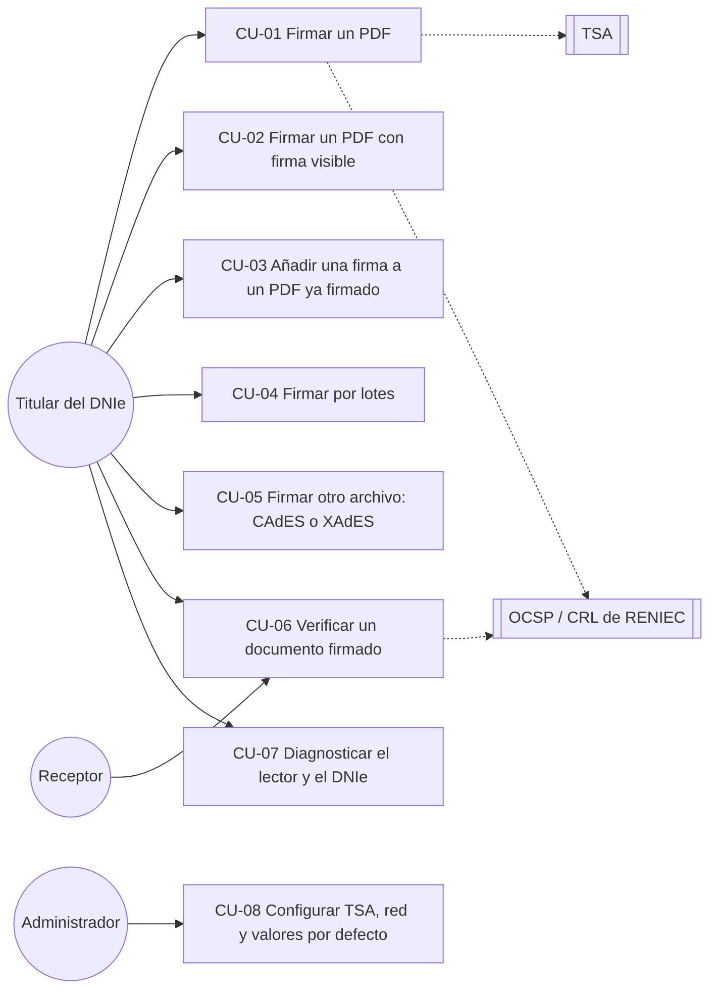

# Casos de uso

| Campo | Valor |
|---|---|
| Documento | BRG-REQ-003 |
| Versión | 0.1.1 |
| Estado | Borrador |
| Fecha | 2026-10-27 |
| Responsable | noggalito |

## 1. Diagrama general

## 2. Especificaciones

### CU-01: Firmar un PDF

| Elemento | Contenido |
|---|---|
| Actor principal | Titular del DNIe |
| Precondiciones | Lector conectado; DNIe con certificados vigentes; berigna instalada |
| Disparador | El usuario abre un PDF en berigna (desde Nautilus, "Abrir con", arrastrándolo o con el botón "Abrir") |
| Requisitos | RF-001 a RF-006, RF-010, RF-011, RF-013, RF-018, RF-045 |

Flujo principal:
1. El sistema muestra la previsualización del PDF y el estado del DNIe ("DNIe de NOMBRE APELLIDO listo").
2. El usuario elige el nivel de firma (preseleccionado según las preferencias) y, opcionalmente, el motivo y la ubicación.
3. El usuario pulsa "Firmar".
4. El sistema valida el certificado del firmante (vigencia, cadena y revocación).
5. El sistema muestra un resumen ("Vas a firmar *contrato.pdf* (3 páginas) como NOMBRE, nivel B-LT") y pide el PIN.
6. El usuario introduce el PIN y confirma.
7. El sistema calcula el *hash*, el chip firma, y el sistema obtiene el sello de tiempo y los datos de validación según el nivel.
8. El sistema guarda `contrato-firmado.pdf` y muestra el resultado con las acciones "Abrir", "Mostrar en carpeta" y "Verificar".

Flujos alternativos:
- 4a. Certificado caducado o revocado: se bloquea la firma y se explica la causa (fin del caso).
- 4b. No hay conexión: se advierte y se ofrece continuar solo en B-B.
- 6a. PIN incorrecto: se muestran los intentos restantes, si el chip los informa, y se vuelve al paso 5.
- 6b. PIN bloqueado: se explica el procedimiento de desbloqueo ante RENIEC (fin del caso).
- 7a. La TSA no responde: se ofrece reintentar, cambiar de TSA o guardar en B-B.
- 7b. Se retira la tarjeta: se aborta sin escribir ningún archivo.

Postcondición: existe un PDF firmado válido y el original no ha cambiado. Si el historial está activado (RF-082, `history-enabled`), la operación queda registrada.

### CU-02: Firmar un PDF con firma visible

Extiende CU-01. Requisitos: RF-012, RF-081.

1. En el paso 2 de CU-01, el usuario activa "Firma visible".
2. El sistema propone el último perfil de apariencia usado y una posición por defecto en la última página.
3. El usuario arrastra o redimensiona el recuadro sobre la previsualización, o cambia de página.
4. El sistema muestra una vista previa en vivo de la apariencia con los datos reales del certificado.
5. Continúa en el paso 3 de CU-01.

### CU-03: Añadir una firma a un PDF ya firmado

Requisitos: RF-014, RF-050, RF-055.

1. El usuario abre un PDF que ya tiene firmas.
2. El sistema verifica las firmas existentes y muestra su estado en un panel lateral.
3. Si alguna firma existente no es válida, el sistema lo advierte antes de dejar continuar.
4. Si el documento está certificado con DocMDP "sin cambios", el sistema impide firmar y explica el motivo.
5. Continúa como CU-01. La nueva firma se añade de forma incremental.

### CU-04: Firmar por lotes

Requisitos: RF-040 a RF-043, RF-045.

1. El usuario selecciona varios archivos (en Nautilus o en berigna) o una carpeta.
2. El sistema muestra la lista con el formato que se aplicará a cada archivo y permite quitar elementos.
3. El usuario elige el nivel y la apariencia (que se aplica a todos los PDF) y pulsa "Firmar N archivos".
4. El sistema valida el certificado y pide el PIN una vez, mostrando el número de archivos.
5. El sistema firma secuencialmente y muestra el progreso (archivo actual, correctos y errores).
6. Al terminar, el sistema muestra el informe del lote, exportable a CSV.

Alternativo: 5a. El usuario cancela; se termina el archivo en curso, se cierra la sesión y el informe marca los archivos restantes como "omitido".

### CU-05: Firmar otro tipo de archivo (CAdES o XAdES)

Requisitos: RF-020 a RF-022, RF-030 a RF-033.

1. El usuario abre un archivo que no es PDF.
2. Si es XML, el sistema propone XAdES envuelta. Si es otro tipo, propone CAdES separada (`.p7s`). El usuario puede cambiar la variante.
3. Como el contenido no siempre se puede previsualizar, el sistema muestra el nombre, el tamaño, el tipo y el *hash* SHA-256 del archivo para cumplir con el principio WYSIWYS, y una vista de texto si el archivo es de texto.
4. Continúa como CU-01 desde el paso 3.

### CU-06: Verificar un documento firmado

Requisitos: RF-050 a RF-056.

1. El usuario abre un archivo firmado (o un `.p7s` junto con su original).
2. El sistema detecta las firmas y valida cada una.
3. El sistema muestra un resumen global (por ejemplo: "2 firmas válidas" o "1 firma con problemas") y el detalle de cada firma: firmante, DNI enmascarado, fecha (declarada o certificada), nivel, indicación ETSI y explicación.
4. El usuario puede exportar el informe (PDF en es_PE o en quechua, o JSON) o abrir la revisión firmada del PDF.

### CU-07: Diagnosticar el lector y el DNIe

Requisitos: RF-007, RF-001 a RF-003.

1. El usuario abre "Diagnóstico" desde el menú o desde un mensaje de error.
2. El sistema ejecuta las comprobaciones en orden y muestra cada resultado (✓ / ✗ / ⚠) con una acción sugerida (por ejemplo: "Instala el paquete `pcscd` y ejecuta `sudo systemctl enable --now pcscd.socket`").
3. El usuario puede copiar el informe para enviarlo a soporte.

### CU-08: Configurar TSA, red y valores por defecto

Requisitos: RF-062 a RF-064, RF-080.

1. El usuario o el administrador abre las preferencias.
2. Configura la TSA y la prueba con el botón "Probar".
3. Ajusta el nivel por defecto, la salida, el proxy y, si lo desea, el idioma de la interfaz (sistema, es_PE o quechua).
4. Un administrador puede fijar valores para toda la organización mediante los valores por defecto de GSettings en el sistema (ver 04-arquitectura/configuracion-y-datos.md).
