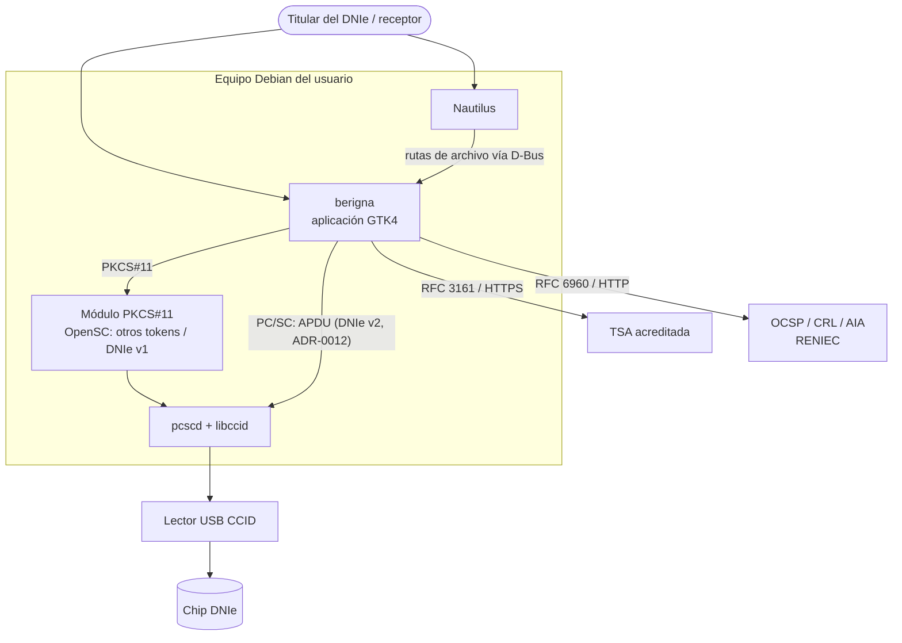
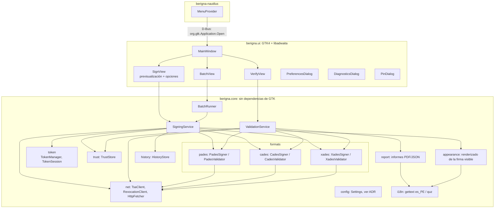

# Arquitectura general

| Campo | Valor |
|---|---|
| Documento | BRG-ARQ-001 |
| Versión | 0.2.0 |
| Estado | Borrador |
| Fecha | 2026-10-27 |
| Responsable | `{{TITULAR}}` |

## 1. Principios

1. Núcleo independiente de la interfaz. `berigna.core` no importa GTK. Esto facilita las pruebas automatizadas y la evaluación para la acreditación, y deja preparada la CLI y el invocador web de la hoja de ruta, aunque la v1 solo tiene GUI.
2. La clave nunca sale del chip. El núcleo solo obtiene del *token* el resultado de la operación de firma.
3. Adaptadores por formato. PAdES, CAdES y XAdES implementan una misma interfaz `Signer` y una misma interfaz `Validator`, de modo que cambiar una biblioteca no afecta al resto del sistema.
4. Mínimo de piezas propias en criptografía. Se usan bibliotecas maduras (pyHanko, cryptography, asn1crypto, python-pkcs11). Solo se escribe código propio para la integración y las reglas del dominio peruano.
5. Explícito ante lo ambiguo. Toda decisión con impacto legal (nivel, certificado, advertencias) se muestra al usuario.
6. Bilingüe desde el diseño (ADR-0011, ADR-0015). El núcleo devuelve resultados con códigos, no frases. La traducción a es_PE o quechua se hace en la capa de presentación y en el generador de informes.

## 2. Contexto (C4, nivel 1)



## 3. Contenedores y módulos (C4, nivel 2-3)



### 3.1 Responsabilidades

| Módulo | Responsabilidad | Bibliotecas (estado al 2026-10-27) |
|---|---|---|
| `core.token` | Detección de lectores y tarjetas, y selección del *backend* según el ATR. Dos *backends* con la misma interfaz `TokenSigner`: `dnie_v2`, driver APDU para el DNIe v2 (*applet* PKI, lectura de certificados, VERIFY, MSE:SET y PSO:CDS, con lista blanca de instrucciones), y `pkcs11`, el genérico (*slots*, login y logout, `C_Sign`) | pyscard (ADR-0012), implementado para el DNIe v2, con monitor en caliente; python-pkcs11 (ADR-0003), aplazado a la versión 1.1 |
| `core.formats.pades` | Firma y validación PAdES, DSS/VRI, sellos de documento, DocMDP. Firma mediante un `Signer` personalizado de pyHanko que delega en `TokenSigner` | pyHanko 0.25.1 (ADR-0004, ADR-0013); implementada la firma B-B, B-T, B-LT y B-LTA |
| `core.formats.cades` | Firma y validación CMS/CAdES separada y envuelta | pyHanko (API CMS genérica), asn1crypto (ADR-0008) |
| `core.formats.xades` | Firma y validación XAdES | Según SPK-03 (ADR-0008) |
| `core.trust` | Almacén de confianza de la IOFE incluido (anclas como recurso del paquete con manifiesto de huellas) y anclas añadidas por el usuario | cryptography; implementado |
| `core.net` | Clientes HTTP para TSA, OCSP, CRL y AIA, con caché, tiempos de espera y proxy | requests. Implementados `fetchers` (OCSP y CRL para validación previa, firma B-LT y verificación) y `tsa` (cliente RFC 3161 sobre el de pyHanko). Caché y proxy, pendientes |
| `core.appearance` | Composición del sello visible a partir de una plantilla de texto y una imagen | pyHanko stamp + Pillow |
| `core.signing` | Orquestación: comprobar que el archivo no cambió, validar el certificado antes del PIN, firmar y escribir de forma atómica | Implementado para PDF (B-B) |
| `core.validation` | Validación previa del firmante (`preflight`, RF-006) y verificación de firmas PDF con indicaciones ETSI (`pdf`, RF-050, RF-053, RF-055) | pyhanko-certvalidator 0.26.3 y la validación AdES de pyHanko 0.25.1; `preflight` implementado; `pdf` con sellos de tiempo y validación en el pasado |
| `core.report` | Informe de verificación en JSON (códigos y explicaciones en ambos idiomas) y en PDF (en es_PE o en quechua) | ReportLab o pyHanko |
| `core.i18n` | Inicialización de gettext, catálogo de explicaciones por código (ETSI y `ERR-xxx`), formato de fechas según la configuración regional y selección explícita del idioma de los documentos generados (informe, sello visible) | gettext, babel o `locale` de la biblioteca estándar |
| `core.history` | Historial local en SQLite | sqlite3 (biblioteca estándar) |
| `core.config` | Acceso tipado a la configuración (GSettings vía una interfaz, para no acoplar el núcleo a GTK) | — |
| `ui` | Vistas, diálogos, previsualización de PDF y manejo de hilos | PyGObject, GTK4, libadwaita, Poppler-GLib o pypdfium2 |
| `berigna-nautilus` | Entradas del menú contextual; solo lanza berigna con las rutas | nautilus-python |

### 3.2 Límites deliberados del driver del DNIe v2

Decisiones de implementación de `core.token.dnie_v2` (ADR-0012), documentadas para la auditoría:

| Decisión | Motivo |
|---|---|
| La lista blanca valida la forma exacta de cada comando (AID, archivos, referencia de PIN, plantilla de MSE, `DigestInfo` SHA-2), no solo la instrucción | AM-19: ninguna ruta de código puede enviar otra cosa al chip |
| `signing_certificate()` solo comprueba el uso de clave (no repudio); la vigencia, la cadena y la revocación las valida la capa de validación (RF-006) | Separación de responsabilidades |
| PSO:CDS se envía sin `Le` | Comportamiento verificado en el DNIe real (SPK-01 §8.6 y HIL del 2026-10-27) |
| Ante un fallo transitorio de PC/SC (`SCARD_E_NOT_TRANSACTED`), SELECT y READ BINARY se reintentan hasta dos veces (50 y 150 ms). VERIFY, MSE:SET y PSO:CDS no se reintentan nunca y la sesión se cierra | Medido: 1 de cada 30 sesiones encadenadas fallaba tras el apagado de la anterior; con la política, 0 de 60. Reenviar un VERIFY podría gastar un intento del PIN (P-06) |
| Límite de longitud del PIN: 255 bytes | Límite de una APDU; la política real la aplica la tarjeta |
| `Pin.buffer()` devuelve el búfer vivo, y su único consumidor es `verify_pin`, que lo borra | P-04; la confianza se limita a un solo punto del código |
| El monitor (`core.token.monitor`) consulta `SCardGetStatusChange` con tiempo de espera 0 y duerme entre sondeos con un `threading.Event` | Decisión deliberada: `stop()` responde de inmediato, sin esperar a que pcscd devuelva una llamada bloqueante ni recurrir a `SCardCancel`; el coste de CPU de dos sondeos por segundo es despreciable |
| Los nombres de lector se normalizan a `str` aunque pyscard los devuelva como `bytes` | El contrato de `ReaderState` no depende de la versión de pyscard |
| `sign_pdf_file` comprueba que el PDF se puede leer antes de validar el certificado y pedir el PIN | Un archivo dañado no le cuesta al usuario teclear el PIN |
| `verify_pdf` elige el proceso de ETSI según la firma: el básico (`ades_basic_validation`) si no tiene sello de tiempo y el de material de validación a largo plazo (`ades_lta_validation`) si lo tiene. La integridad del PDF (cobertura, diferencias) se calcula por separado | `ades_lta_validation` exige un sello de tiempo y da INDETERMINATE a toda firma B-B; y `ades_basic_validation` de pyHanko 0.25.1 falla si se le pide el estado propio de PDF |
| Si pyHanko devuelve la subindicación genérica `CERTIFICATE_CHAIN_GENERAL_FAILURE` en el proceso básico, la cadena se valida otra vez por separado y la subindicación se precisa según el error: falta de datos de revocación → `TRY_LATER`, certificado vencido en la cadena → `OUT_OF_BOUNDS_NO_POE`, aún no vigente → `NOT_YET_VALID`. Si esta vez pasa, el primer fallo fue transitorio → `TRY_LATER` | pyHanko 0.25.1 agrupa esas causas, que ETSI EN 319 102-1 (§5.2.6) distingue y DSS informa por separado. Cada una lleva una explicación distinta para el usuario (RF-053) |
| Cada sello (de firma y de documento) se informa con su propia indicación (§5.4). Si pyHanko no devuelve el estado del sello de la firma, porque el proceso se detuvo antes, el sello se valida aparte | RF-053: un sello inválido se muestra aunque la firma sea válida, y al revés |
| Al verificar, la indicación ETSI y las modificaciones posteriores se informan por separado; una cobertura que no abarca una revisión completa es TOTAL-FAILED/FORMAT_FAILURE | La firma puede ser íntegra aunque el documento cambiara después (RF-055); un rango de bytes parcial es la huella de un ataque de envoltura (AM-05) |
| En línea (validación previa, firma B-LT y verificación), nunca se descarga la CRL de un certificado final (solo OCSP); las CRL se descargan para las CA. Cada consulta OCSP o CRL fallida se reintenta una vez tras 0,5 s (`core.net.fetchers`) | La CRL de la CA emisora del DNIe pesa ~109 MB (RF-063). RENIEC ha fallado la primera consulta tras un rato sin uso y respondido la siguiente en ≈1 s (R-17) |
| Un nivel por encima de B-B exige, antes de pedir el PIN, revocación comprobada y una TSA que acabe de emitir un sello de prueba | Ninguno de esos fallos le cuesta al usuario teclear el PIN (RF-006) |
| B-LT y B-LTA se añaden después de que la tarjeta firmó, como actualizaciones incrementales. Si falla un servicio en ese punto, se conserva la firma y el resultado indica el nivel alcanzado y el motivo | No se pierde una firma ya hecha; la interfaz debe avisar del nivel real. Un fallo de la TSA al sellar la firma misma sí anula la operación (no se escribe nada) |
| La comprobación de la TSA tiene un plazo total (30 s por defecto) y su petición HTTP es síncrona, en un hilo *daemon* propio | El tiempo de espera de `requests` es por operación: con IPv6 roto, urllib3 espera ese tiempo por cada dirección IPv6 de la TSA (visto con freetsa.org). El cliente de pyHanko usa `asyncio.to_thread`, cuyos hilos no son *daemon* y bloquearían el cierre de la aplicación |

## 4. Interfaces clave del núcleo

Implementadas (Fase 1):

```python
class TokenSigner(Protocol):                      # core.token.base
    def signing_certificate(self) -> x509.Certificate: ...
    def verify_pin(self, pin: Pin) -> None: ...   # un solo intento; borra el PIN
    def sign_digest(self, digest: bytes, algorithm: HashAlgorithmName = "sha256") -> bytes: ...
    def close(self) -> None: ...                  # también como gestor de contexto

def check_signer(certificate, store, *, moment=None, online=True,
                 ocsp_responses=(), crls=(), timeout=10.0) -> SignerCheck   # core.validation
# SignerCheck: revocation_checked, chain, moment y revocation_note (OFFLINE o UNAVAILABLE
# cuando no se pudo comprobar la revocación y solo cabe B-B)

def verify_pdf(data, store, *, moment=None, online=True, ocsp_responses=(), crls=(),
               timeout=10.0) -> PdfVerification                          # core.validation
# PdfVerification: signatures (PdfSignatureReport: indicación y subindicación ETSI, firmante,
# cobertura, modificaciones posteriores, longitud de la revisión firmada y sello de tiempo de
# la firma) y document_timestamps (TimestampReport de cada sello de documento)

def sign_pdf_file(source, output, *, expected_sha256, token, store, ask_pin, options=None,
                  level=SignatureLevel.B_B, timestamper=None, online=True,
                  ocsp_responses=(), crls=()) -> SignResult                     # core.signing
# SignResult.level es el nivel alcanzado; level_note explica por qué es inferior al pedido

def http_timestamper(TsaSettings(url, timeout, username, password)) -> TimeStamper  # core.net.tsa
def probe(timestamper, md_algorithm="sha256", deadline=30.0) -> None              # core.net.tsa
```

Diseño previsto para las fases siguientes (no es código final):


```python
# Pseudocódigo de diseño, no es código final.

class SignatureLevel(Enum):
    B_B = "B-B"; B_T = "B-T"; B_LT = "B-LT"; B_LTA = "B-LTA"

class SignatureFormat(Enum):
    PADES = auto(); CADES_DETACHED = auto(); CADES_ENVELOPING = auto()
    XADES_ENVELOPED = auto(); XADES_ENVELOPING = auto(); XADES_DETACHED = auto()

@dataclass(frozen=True)
class SignRequest:
    source: Path
    source_digest: bytes          # SHA-256 de los bytes previsualizados (RF-018)
    output: Path
    format: SignatureFormat
    level: SignatureLevel
    metadata: SignMetadata         # motivo, ubicación, contacto
    appearance: Appearance | None  # solo PAdES visible
    certify: DocMdpLevel | None

class Signer(Protocol):
    def sign(self, req: SignRequest, key: TokenSigner, ctx: SignContext) -> SignResult: ...

class Validator(Protocol):
    def validate(self, target: Path, ctx: ValidationContext) -> list[SignatureReport]: ...

class TokenSigner(Protocol):
    certificate: x509.Certificate
    chain: list[x509.Certificate]
    def sign_digest(self, digest: bytes, algorithm: str) -> bytes: ...
```

## 5. Modelo de concurrencia

- La interfaz se ejecuta en el bucle principal de GLib.
- Las operaciones del núcleo se ejecutan en un único hilo de trabajo dedicado al *token* (las llamadas al *token*, sea PKCS#11 o APDU sobre una única conexión PC/SC, se serializan). La red y la validación pueden usar un pool de hilos aparte.
- `check_signer` (y por tanto `sign_pdf_file`) crea su propio bucle de asyncio para pyhanko-certvalidator: debe llamarse desde un hilo de trabajo, nunca desde dentro de un bucle de asyncio en marcha.
- La comunicación hacia la interfaz se hace con `GLib.idle_add` o con `Gio.Task`. La cancelación usa `Gio.Cancellable`, que se traduce a un token de cancelación del núcleo.
- La detección de lectores y tarjetas (`core.token.monitor`) sondea cada 0,5 s con `SCardGetStatusChange` en un hilo propio, sin conectarse a la tarjeta, de modo que no interfiere con una sesión de firma exclusiva. Solo avisa cuando cambia el estado (sin servicio PC/SC, sin lector, sin tarjeta, tarjeta no compatible con su ATR, DNIe listo), y la interfaz debe pasar el aviso al bucle principal con `GLib.idle_add`.

## 6. Proceso y empaquetado

- Un solo proceso `berigna`, con `Adw.Application` y un `application-id` único: `pe.berigna.Berigna` (provisional, depende de DP-05; debe ser un dominio controlado por el titular).
- La extensión de Nautilus es un módulo Python aparte, instalado en el directorio de extensiones de nautilus-python, en un paquete binario propio (`berigna-nautilus`).
- Estructura de paquetes Debian: `berigna` (aplicación), `berigna-nautilus` (extensión), `python3-berigna-core` (opcional, si se separa el núcleo).

## 7. Decisiones de arquitectura

Ver [adr/README.md](adr/README.md).

## 8. Puntos abiertos

- Driver de OpenSC para el DNIe v2 (línea paralela de ADR-0012): repositorio, mantenedor y plan de envío *upstream*.

- Previsualización de PDF: Poppler-GLib (vía GObject Introspection, ya integrada en Debian) frente a pypdfium2 (mejor fidelidad, pero no empaquetada en Debian). Se decide en la Fase 3 con un ADR.
- Si el núcleo se publica como una biblioteca separada (`python3-berigna-core`) o solo como un paquete interno.
