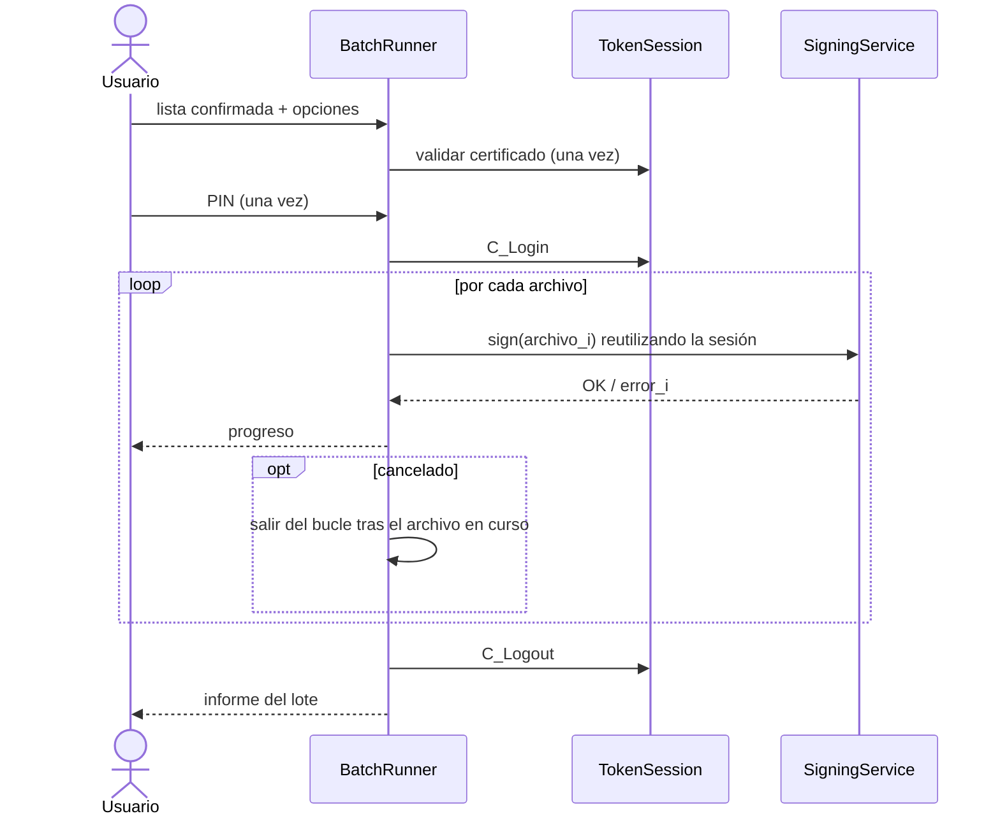
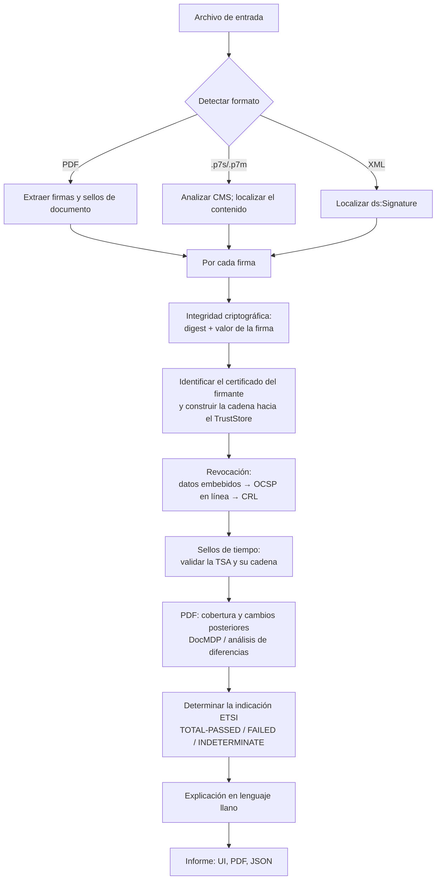
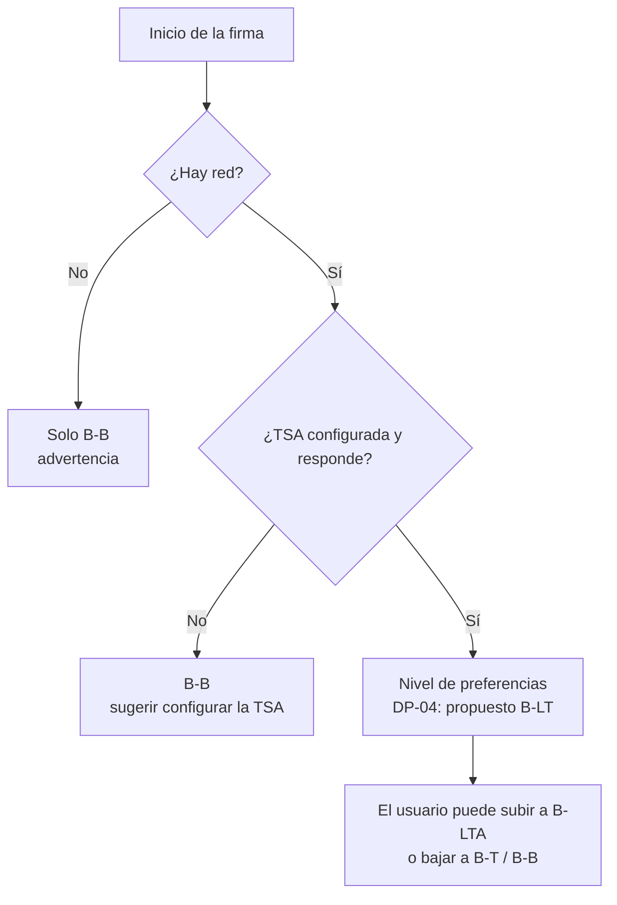

# Flujos de firma y verificación

| Campo | Valor |
|---|---|
| Documento | BRG-ARQ-002 |
| Versión | 0.3.0 |
| Estado | Borrador |
| Fecha | 2026-11-01 |
| Responsable | noggalito |

## 1. Firma PAdES (nivel seleccionable)

```mermaid
sequenceDiagram
  autonumber
  actor U as Usuario
  participant UI as berigna.ui
  participant S as SigningService
  participant T as TokenSession (PKCS#11)
  participant V as TrustStore + RevocationClient
  participant P as PadesSigner (pyHanko)
  participant TSA as TSA
  participant R as OCSP/CRL

  U->>UI: Abre PDF
  UI->>UI: Lee bytes, calcula SHA-256 y previsualiza
  U->>UI: Elige nivel, opciones y pulsa Firmar
  UI->>S: prepare(SignRequest)
  S->>T: leer certificado de no repudio y cadena (sin PIN)
  S->>V: validar vigencia, cadena y revocación
  V->>R: OCSP (sin respaldo de CRL al firmar; RF-063)
  R-->>V: estado
  V-->>S: OK / error / no verificable
  S-->>UI: resumen para confirmar
  UI->>U: Resumen + diálogo de PIN
  U->>UI: PIN
  UI->>S: execute(pin)
  S->>S: comprobar que el SHA-256 del archivo en disco sigue igual (RF-018)
  S->>T: C_Login(PIN), luego se borra el PIN
  S->>P: firmar(bytes, TokenSigner, nivel)
  P->>P: actualización incremental, ByteRange, atributos firmados
  P->>T: sign(digest de los atributos firmados)
  T-->>P: valor de la firma (calculado en el chip)
  alt nivel ≥ B-T
    P->>TSA: TimeStampReq(hash de la firma)
    TSA-->>P: TimeStampToken
  end
  alt nivel ≥ B-LT
    P->>R: OCSP/CRL de la cadena del firmante y de la TSA
    P->>P: escribir el diccionario DSS (certificados, OCSP, CRL)
  end
  alt nivel = B-LTA
    P->>TSA: sello de documento (DocTimeStamp)
  end
  P-->>S: bytes del PDF firmado
  S->>S: escritura atómica (tmp + fsync + rename)
  S->>T: C_Logout / cerrar sesión
  S-->>UI: SignResult
  UI->>U: Resultado + acciones
```

Notas:
- Si la TSA falla en el paso del sello, no queda ningún archivo escrito (todo ocurre en memoria o en un temporal). Se ofrece reintentar o bajar a B-B (CU-01, 7a).
- En B-LT, los datos de validación incluyen también los de la cadena del certificado de la TSA.
- La operación en el chip es una sola por firma. El resto del trabajo ocurre fuera del chip.
- Si un servicio falla después de que el chip ha firmado (datos de validación, ruta de la TSA que no se puede construir, sello de documento), la firma no se pierde: se escribe con el nivel alcanzado y `SignResult.level_note` dice por qué es inferior al pedido.

### 1.1 Firma CAdES de cualquier archivo (RF-020 a RF-022)

Mismo orden de pasos que PAdES (`core.signing.sign_cades_file`), con estas diferencias:

- El archivo puede ser de cualquier tipo y nunca se modifica. No hay comprobación de PDF firmable.
- La salida es `<archivo>.p7s` (separada: solo la firma) o `<archivo>.p7m` (envuelta: la firma y una copia del archivo). Si el nombre existe, el número va antes de la extensión del archivo (`acta-2.xml.p7m`), para que al quitar `.p7m` o `.p7s` el nombre conserve su tipo (RF-045).
- B-T: sello de tiempo de la firma (`signature-time-stamp`).
- B-LT: los certificados de las rutas del firmante y de la TSA (sin las anclas) van en `SignedData.certificates`; las CRL y las respuestas OCSP, sin repetir, en `SignedData.crls`, las OCSP como `id-ri-ocsp-response` (RFC 5940).
- B-LTA: `archive-time-stamp-v3` con su `ats-hash-index-v3` (ETSI EN 319 122-1 §5.5.3). La huella del contenido sale del atributo firmado `message-digest`, sin volver a calcularla.
- Validación externa: BRG-CAL-006.

### 1.2 Firma XAdES de documentos XML (RF-030 a RF-033)

Mismo orden de pasos que PAdES (`core.signing.sign_xades_file`), con estas diferencias:

- El archivo es un documento XML; si no lo es, se rechaza con `UnreadableDocumentError` antes del PIN. Nunca se modifica.
- Tres variantes (RF-030 a RF-032): envuelta, la firma dentro del documento; envolvente, el documento dentro de `ds:Object` de la firma; separada, la firma en un archivo propio que referencia al documento. La salida de la envuelta y de la envolvente es el documento firmado, `<nombre><sufijo>.xml` (como el PDF firmado); la de la separada es solo la firma, `<nombre>.xml.xsig`, con el número antes de la extensión del archivo (`acta-2.xml.xsig`), para que al quitar `.xsig` quede el nombre del documento (RF-045). La separada referencia al documento por su nombre, sin ruta.
- B-B: signxml 4.0.5 (Debian 13) con C14N 1.0 inclusiva y `SigningCertificate` solo con el certificado del firmante (ADR-0008); la operación de clave privada va al chip a través de `TokenSigner` (RNF-SEG-01).
- B-T: `xades:SignatureTimeStamp` sobre la C14N exclusiva de `ds:SignatureValue` (EN 319 132-1 §5.4.1). Si la TSA falla aquí, `TsaError` y no queda archivo escrito.
- B-LT: `CertificateValues` y `RevocationValues` con los certificados de las rutas del firmante y de la TSA (sin las anclas), las CRL y las respuestas OCSP, cada una una sola vez (EN 319 132-1 §5.4.3; con el DNIe, OCSP, SPK-02). Un fallo de los servicios baja al B-T alcanzado, con el motivo.
- B-LTA: `xades141:ArchiveTimeStamp` sobre los objetos de datos (las referencias, con el *transform* envuelto aplicado), `SignedInfo`, `SignatureValue`, `KeyInfo`, las propiedades no firmadas y los demás `ds:Object` (todos menos el de `QualifyingProperties`, también los referenciados; EN 319 132-1 §5.4.2, SPK-03 §4). Un fallo baja al B-LT, con el motivo.
- Validación externa: BRG-CAL-006 §3.3.

## 2. Firma por lotes



Con el *backend* PKCS#11: si el objeto de clave tiene `CKA_ALWAYS_AUTHENTICATE = true`, cada firma requiere `C_Login(CKU_CONTEXT_SPECIFIC)`.

Con el driver del DNIe v2 (ADR-0012), "C_Login" equivale a VERIFY del PIN 0x81 y "C_Logout" a reiniciar o apagar la tarjeta (volver a seleccionar el *applet* no anula el VERIFY). Comprobado (SPK-01 §8.6): la autenticación persiste entre varias PSO:CDS, así que el lote pide el PIN una sola vez. El "logout" es `SCardDisconnect(SCARD_UNPOWER_CARD)`, y toda la sesión usa una conexión exclusiva (ADR-0012).

En el diagrama de firma PAdES de §1, para el DNIe v2, `T` es el driver APDU y la llamada `sign(digest)` se traduce en MSE:SET (`00 22 41 B6`) seguido de PSO:CDS (`00 2A 9E 9A`) con el `DigestInfo`.

## 3. Verificación



## 4. Árbol de decisiones para el nivel por defecto


