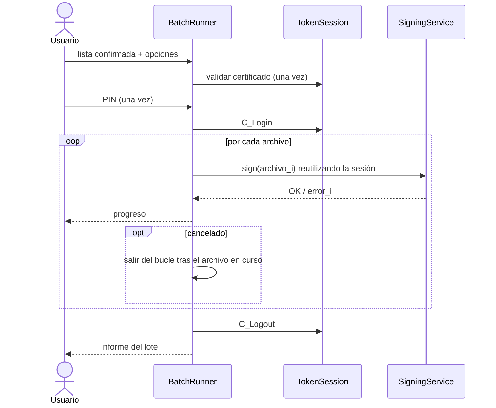
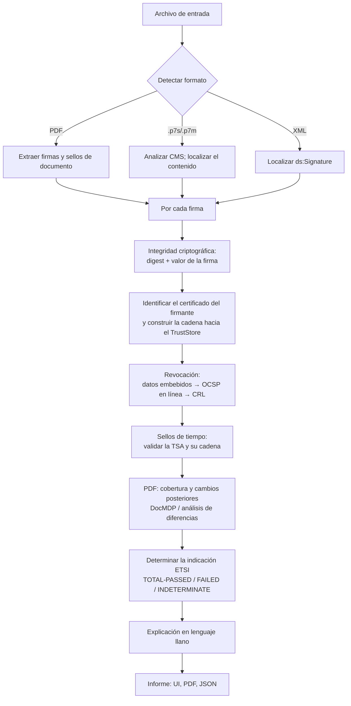
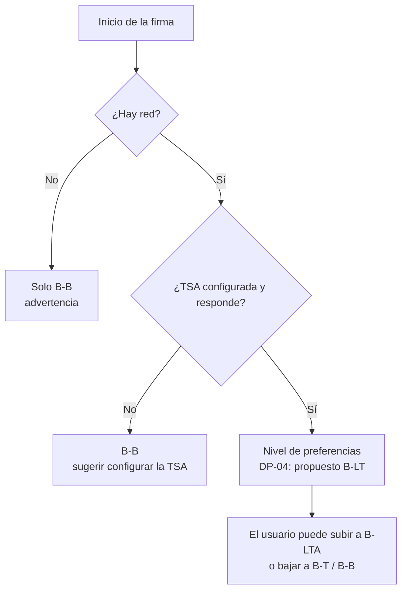

# Flujos de firma y verificación

| Campo | Valor |
|---|---|
| Documento | BRG-ARQ-002 |
| Versión | 0.1.0 |
| Estado | Borrador |
| Fecha | 2026-10-27 |
| Responsable | `{{TITULAR}}` |

## 1. Firma PAdES (nivel seleccionable)

```mermaid
sequenceDiagram
  autonumber
  actor U as Usuario
  participant UI as berigna.ui
  participant S as SigningService
  participant T as TokenSession (PKCS#11)
  participant V as TrustStore + RevocationClient
  participant P as PadesSigner (pyHanko)
  participant TSA as TSA
  participant R as OCSP/CRL

  U->>UI: Abre PDF
  UI->>UI: Lee bytes, calcula SHA-256 y previsualiza
  U->>UI: Elige nivel, opciones y pulsa Firmar
  UI->>S: prepare(SignRequest)
  S->>T: leer certificado de no repudio y cadena (sin PIN)
  S->>V: validar vigencia, cadena y revocación
  V->>R: OCSP (sin respaldo de CRL al firmar; RF-063)
  R-->>V: estado
  V-->>S: OK / error / no verificable
  S-->>UI: resumen para confirmar
  UI->>U: Resumen + diálogo de PIN
  U->>UI: PIN
  UI->>S: execute(pin)
  S->>S: comprobar que el SHA-256 del archivo en disco sigue igual (RF-018)
  S->>T: C_Login(PIN), luego se borra el PIN
  S->>P: firmar(bytes, TokenSigner, nivel)
  P->>P: actualización incremental, ByteRange, atributos firmados
  P->>T: sign(digest de los atributos firmados)
  T-->>P: valor de la firma (calculado en el chip)
  alt nivel ≥ B-T
    P->>TSA: TimeStampReq(hash de la firma)
    TSA-->>P: TimeStampToken
  end
  alt nivel ≥ B-LT
    P->>R: OCSP/CRL de la cadena del firmante y de la TSA
    P->>P: escribir el diccionario DSS (certificados, OCSP, CRL)
  end
  alt nivel = B-LTA
    P->>TSA: sello de documento (DocTimeStamp)
  end
  P-->>S: bytes del PDF firmado
  S->>S: escritura atómica (tmp + fsync + rename)
  S->>T: C_Logout / cerrar sesión
  S-->>UI: SignResult
  UI->>U: Resultado + acciones
```

Notas:
- Si la TSA falla en el paso del sello, no queda ningún archivo escrito (todo ocurre en memoria o en un temporal). Se ofrece reintentar o bajar a B-B (CU-01, 7a).
- En B-LT, los datos de validación incluyen también los de la cadena del certificado de la TSA.
- La operación en el chip es una sola por firma. El resto del trabajo ocurre fuera del chip.

## 2. Firma por lotes



Con el *backend* PKCS#11: si el objeto de clave tiene `CKA_ALWAYS_AUTHENTICATE = true`, cada firma requiere `C_Login(CKU_CONTEXT_SPECIFIC)`.

Con el driver del DNIe v2 (ADR-0012), "C_Login" equivale a VERIFY del PIN 0x81 y "C_Logout" a reiniciar o apagar la tarjeta (volver a seleccionar el *applet* no anula el VERIFY). Comprobado (SPK-01 §8.6): la autenticación persiste entre varias PSO:CDS, así que el lote pide el PIN una sola vez. El "logout" es `SCardDisconnect(SCARD_UNPOWER_CARD)`, y toda la sesión usa una conexión exclusiva (ADR-0012).

En el diagrama de firma PAdES de §1, para el DNIe v2, `T` es el driver APDU y la llamada `sign(digest)` se traduce en MSE:SET (`00 22 41 B6`) seguido de PSO:CDS (`00 2A 9E 9A`) con el `DigestInfo`.

## 3. Verificación



## 4. Árbol de decisiones para el nivel por defecto


