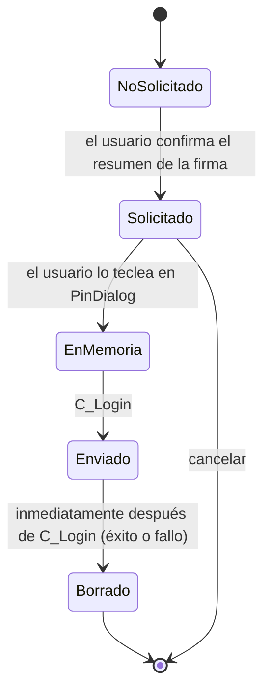

# Manejo del PIN y de las credenciales

| Campo | Valor |
|---|---|
| Documento | BRG-SEG-002 |
| Versión | 0.1.0 |
| Estado | Borrador |
| Fecha | 2026-10-27 |
| Responsable | `{{TITULAR}}` |

## 1. Ciclo de vida del PIN

## 2. Reglas

| Regla | Detalle |
|---|---|
| P-01 | El PIN se pide solo después de que el usuario vea qué va a firmar (WYSIWYS) |
| P-02 | No se guarda nunca: ni en disco, ni en GSettings, ni en el llavero, ni en el historial |
| P-03 | No se registra nunca. El registro filtra cualquier objeto `Pin` y el tipo `Pin` tiene un `__repr__` que devuelve `"Pin(***)"` |
| P-04 | Vive en un `bytearray` mutable que se sobrescribe con ceros después de `C_Login`. Se documenta la limitación de que Python y GTK (el búfer de `Gtk.PasswordEntry`) pueden dejar copias que no se pueden controlar |
| P-05 | El widget es `Gtk.PasswordEntry`, que oculta los caracteres e impide copiar |
| P-06 | Nunca se reintenta un login automáticamente. Cada intento es una acción explícita del usuario |
| P-07 | Antes de enviar el PIN se advierte al usuario si quedan pocos intentos. Con PKCS#11 se leen `CKF_USER_PIN_COUNT_LOW`, `CKF_USER_PIN_FINAL_TRY` y `CKF_USER_PIN_LOCKED`. Con el driver del DNIe v2 los intentos se conocen por la respuesta `63Cx` de un VERIFY fallido, y se muestran antes del siguiente intento |
| P-08 | Si el lector tiene PIN pad, no se muestra el campo; se indica "Introduce tu PIN en el lector". Con PKCS#11: `CKF_PROTECTED_AUTHENTICATION_PATH` y `C_Login` con PIN nulo. Con el DNIe v2: `FEATURE_VERIFY_PIN_DIRECT` (PC/SC parte 10, `SCardControl`), y la tarjeta recibe el VERIFY desde el lector |
| P-09 | La sesión autenticada se cierra al terminar la operación o el lote, al cancelar, al retirar la tarjeta o al cerrar la aplicación. Con PKCS#11: `C_Logout` y `C_CloseSession`. Con el DNIe v2: `SCardDisconnect(SCARD_UNPOWER_CARD)`, porque volver a seleccionar el *applet* no anula el VERIFY (SPK-01 §8.6). Durante la sesión, la conexión PC/SC es exclusiva |
| P-10 | Se mitigan los volcados de memoria: `prctl(PR_SET_DUMPABLE, 0)` mientras dura la sesión de firma, y se valora `mlock` en el búfer del PIN. Su viabilidad desde Python se comprueba al implementar el driver en la Fase 1 (tarea de la hoja de ruta), no en SPK-01 |
| P-11 | El cambio y el desbloqueo del PIN no forman parte de la v1: se remite a los canales de RENIEC. `[VERIFICAR]` si RENIEC permite cambiar el PIN con software de terceros (consulta CE-08) |

## 3. Otras credenciales

| Credencial | Almacenamiento | Nota |
|---|---|---|
| Usuario y contraseña de la TSA | libsecret (Secret Service) | Nunca en GSettings |
| Certificado de cliente para la TSA | Archivo PKCS#12 protegido con una contraseña guardada en libsecret, o un *token* PKCS#11 | Opcional, solo si la TSA lo exige (DP-02) |
| Contraseña de un PDF cifrado | Solo en memoria durante la operación | No se recuerda |

## 4. Pruebas asociadas

Las pruebas con un DNIe real siguen el [protocolo de pruebas con PIN](../07-calidad/protocolo-pruebas-con-pin.md).

- PR-SEG-01: se busca el PIN de prueba en los registros en nivel DEBUG tras 100 firmas; el resultado esperado es cero coincidencias.
- PR-SEG-02: el PIN no aparece en GSettings, en el historial ni en la caché.
- PR-SEG-03: con el indicador `FINAL_TRY` simulado en SoftHSM (o con un *mock*), se muestra la advertencia.
- PR-SEG-04: retirar la tarjeta durante un lote cierra la sesión y no deja archivos parciales.
- PR-SEG-05: tras cualquier firma, lote, cancelación o error, una PSO:CDS lanzada desde otro proceso sin VERIFY devuelve `6982` (la sesión quedó cerrada). Se ejecuta en HIL y con el simulador.
- PR-SEG-06: durante una sesión autenticada, otro proceso no puede conectarse a la tarjeta (conexión exclusiva).
