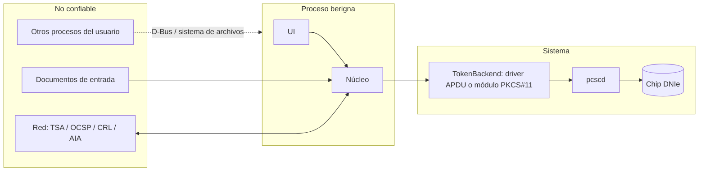

# Modelo de amenazas

| Campo | Valor |
|---|---|
| Documento | BRG-SEG-001 |
| Versión | 0.1.0 |
| Estado | Borrador |
| Fecha | 2026-10-27 |
| Responsable | noggalito |

Metodología: STRIDE aplicado a los flujos de 04-arquitectura. Se revisa en cada fase y antes de cada versión.

## 1. Activos

| Activo | Por qué importa |
|---|---|
| Clave privada de firma (en el chip) | Permite suplantar legalmente al titular |
| PIN del DNIe | Da acceso a la clave; tras varios intentos fallidos se bloquea el DNIe |
| Intención del firmante | El usuario debe firmar exactamente lo que cree que firma |
| Integridad de los documentos firmados | Valor probatorio |
| Resultado de la verificación | Un falso "válido" engaña al receptor |
| Almacén de confianza | Decide quién es un firmante legítimo |
| Binario y paquete de berigna | Base de la acreditación |
| Datos personales (nombre, DNI, historial) | Ley de protección de datos personales |

## 2. Límites de confianza

Fuera del alcance: un sistema operativo comprometido con privilegios de root o con un *keylogger* activo. berigna no puede protegerse de un sistema comprometido. La mitigación parcial es el soporte de lectores con PIN pad.

## 3. Amenazas y controles

| ID | STRIDE | Amenaza | Impacto | Prob. | Controles | Riesgo residual |
|---|---|---|---|---|---|---|
| AM-01 | Spoofing | Un proceso malicioso usa la sesión autenticada de berigna (PKCS#11, o el DNIe v2 tras un VERIFY) para firmar otros datos. En el DNIe v2 la autenticación persiste hasta reiniciar la tarjeta (SPK-01 §8.6) | Alto | Media | CS-01: la sesión dura solo lo que dura la operación o el lote; conexión PC/SC exclusiva durante la sesión; cierre obligatorio con `SCARD_UNPOWER_CARD`/`SCARD_RESET_CARD` en `finally`; PR-SEG-05 y PR-SEG-06 | Bajo |
| AM-02 | Tampering | El archivo cambia entre la previsualización y la firma (TOCTOU) | Alto | Media | CS-02: se firman los bytes previsualizados y se compara el SHA-256 antes de firmar (RF-018) | Bajo |
| AM-03 | Tampering | El PDF muestra un contenido distinto según el visor (contenido oculto, capas opcionales, JavaScript) | Alto | Media | CS-03: avisar si el PDF tiene JavaScript, acciones automáticas, capas opcionales, archivos adjuntos o formularios XFA; la previsualización se hace con un motor estándar | Medio |
| AM-04 | Tampering | Lote con archivos que el usuario no pretendía firmar (por ejemplo, una selección recursiva amplia) | Alto | Media | CS-04: lista explícita y confirmada, con el número de archivos mostrado en el diálogo del PIN (RF-040) | Bajo |
| AM-05 | Spoofing | Ataques sobre firmas PDF: *Incremental Saving Attack*, *Signature Wrapping*, *Universal Signature Forgery*, *Shadow Attacks* | Alto | Media | CS-05: la validación comprueba el ByteRange completo, la cobertura de cada revisión y la clasificación de cambios posteriores (RF-055); se prueba con corpus públicos de ataques | Medio |
| AM-06 | Spoofing | Ataques XML: *XML Signature Wrapping* | Alto | Media | CS-06: se resuelven las referencias de forma estricta, se valida lo que realmente está referenciado y se muestra al usuario | Medio |
| AM-07 | Tampering | Respuesta OCSP, CRL o sello de tiempo manipulado en tránsito | Medio | Baja | CS-07: todas las respuestas se validan criptográficamente contra el almacén de confianza; HTTPS cuando está disponible | Bajo |
| AM-08 | Tampering | Se añade una raíz falsa al almacén de confianza | Alto | Baja | CS-08: el almacén del sistema está protegido por el paquete y su manifiesto; las anclas del usuario se marcan en los informes (ADR-0009) | Bajo |
| AM-09 | Repudiation | El titular niega haber firmado | Medio | — | Inherente a la firma digital; el historial local es solo informativo | Aceptado |
| AM-10 | Information disclosure | El PIN aparece en los registros, en volcados de memoria o en el *swap* | Alto | Media | CS-09: ver manejo-de-pin-y-credenciales.md | Medio |
| AM-11 | Information disclosure | Fuga de documentos o metadatos a la red | Alto | Baja | CS-10: solo salen *hash* e identificadores (RNF-SEG-03); sin telemetría | Bajo |
| AM-12 | Information disclosure | El historial revela qué documentos firmó el usuario | Medio | Media | CS-11: permisos 0600, se puede desactivar y borrar, y por defecto no guarda la ruta completa | Bajo |
| AM-13 | Denial of service | Bloqueo del PIN por intentos fallidos inducidos (por ejemplo, reintentos automáticos) | Alto | Baja | CS-12: nunca se reintenta un login de forma automática; se avisa cuando quedan pocos intentos | Bajo |
| AM-14 | Denial of service | Un PDF o XML malicioso agota la CPU o la memoria | Medio | Media | CS-13: límites de tamaño y de tiempo, parser XML sin entidades, *fuzzing* | Bajo |
| AM-15 | Elevation of privilege | Una vulnerabilidad en el análisis de archivos permite ejecutar código | Alto | Baja | CS-14: Python (memoria segura) más bibliotecas nativas actualizadas por Debian; *fuzzing*; sin `eval` ni deserialización insegura | Bajo |
| AM-16 | Tampering | Un argumento manipulado desde Nautilus o D-Bus (rutas con inyección de comandos o enlaces simbólicos) | Medio | Baja | CS-15: la extensión no ejecuta shell; las rutas se pasan como URIs de GIO y se resuelven y validan en la aplicación | Bajo |
| AM-17 | Tampering | Cadena de suministro: dependencia o paquete comprometido | Alto | Baja | CS-16: versiones fijadas, compilación reproducible, repositorio firmado, revisión de cambios en las dependencias (RNF-SEG-06, RNF-SEG-08) | Medio |
| AM-18 | Spoofing | Una versión modificada de berigna se presenta como la acreditada | Medio | Media | CS-17: firma de los paquetes, publicación de las sumas, e indicación en "Acerca de" de si el build es oficial | Medio |
| AM-19 | Tampering / DoS | El driver APDU propio envía un comando no previsto a la tarjeta (por un error o una manipulación) y bloquea el PIN o altera el estado del *applet* | Alto | Baja | CS-18: lista blanca de instrucciones (SELECT, READ BINARY, VERIFY, MSE:SET, PSO:CDS) aplicada en el código; uso exclusivo de la tarjeta por transacción; pruebas con simulador (ADR-0012) | Bajo |

## 4. Tareas

- [ ] Revisar este modelo al cerrar cada fase.
- [ ] Incorporar los corpus de ataques PDF y XML al banco de pruebas (07-calidad §7).
- [ ] Revisión externa del modelo antes de la Fase 7.
