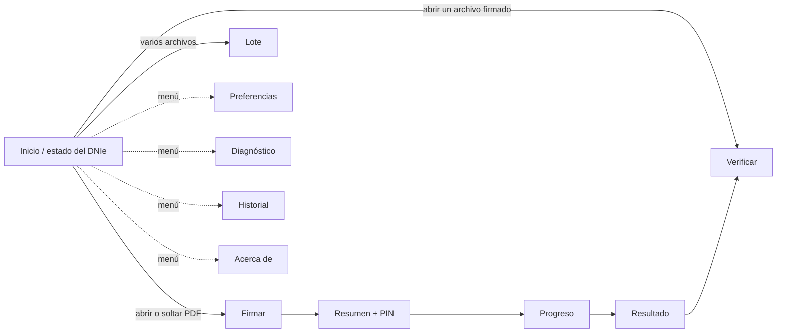

# Diseño de interfaz

| Campo | Valor |
|---|---|
| Documento | BRG-UX-001 |
| Versión | 0.2.0 |
| Estado | Borrador (bocetos de baja fidelidad) |
| Fecha | 2026-10-27 |
| Responsable | `{{TITULAR}}` |

## 1. Principios de UX

1. Un camino principal obvio: abrir → revisar → firmar → listo.
2. El estado del DNIe siempre está visible: lector, tarjeta y titular.
3. Lenguaje llano: "Firma con sello de tiempo" antes que "B-T". El código técnico aparece como texto secundario.
4. No hay sorpresas legales: el nivel, el certificado y el documento se muestran antes del PIN.
5. Errores accionables: qué pasó, por qué y qué hacer, con un botón hacia el diagnóstico.
6. Cumplimiento de la HIG de GNOME y de libadwaita: `AdwHeaderBar`, `AdwToastOverlay`, `AdwPreferencesDialog`, `AdwStatusPage`.
7. Dos idiomas con el mismo cuidado: cada texto se redacta en es_PE y en en_US con el mismo tono llano. No se traduce palabra por palabra. Los bocetos de §3 están en es_PE; los textos en_US salen del catálogo (ADR-0011).
8. Diseño para longitudes variables: ninguna etiqueta depende de una anchura fija, porque los textos pueden crecer hasta un 40 % entre idiomas (RNF-USA-08).

## 2. Mapa de navegación



## 3. Bocetos

### 3.1 Inicio

```
┌──────────────────────────────────────────────────────────────┐
│ ☰                         berigna                       ─ □ ✕ │
├──────────────────────────────────────────────────────────────┤
│                                                              │
│                         [ icono ]                            │
│                                                              │
│              Arrastra aquí un documento para                 │
│                   firmarlo o verificarlo                     │
│                                                              │
│                  [ Abrir documento… ]                        │
│                                                              │
├──────────────────────────────────────────────────────────────┤
│ ● DNIe listo · NOMBRE APELLIDO APELLIDO · vence 21/01/2028   │
└──────────────────────────────────────────────────────────────┘
  Estados de la barra inferior:
  ○ Conecta un lector de tarjetas          [Diagnóstico]
  ○ Inserta tu DNIe en el lector
  ⚠ Tarjeta no compatible                  [Más información]
  ⚠ Certificado vencido / revocado
```

### 3.2 Firmar

```
┌──────────────────────────────────────────────────────────────┐
│ ←  contrato.pdf                                  [ Firmar ]  │
├────────────────────────────────────┬─────────────────────────┤
│                                    │ Nivel de firma          │
│   ┌──────────────────────────┐     │ ◉ Validación a largo    │
│   │                          │     │   plazo (B-LT)          │
│   │   previsualización       │     │ ○ Archivo a largo plazo │
│   │   de la página           │     │   (B-LTA)               │
│   │                          │     │ ○ Con sello de tiempo   │
│   │        ┌────────┐        │     │   (B-T)                 │
│   │        │ firma  │ ←arrastrable │ ○ Básica (B-B)          │
│   │        └────────┘        │     │ ⓘ ¿Qué nivel elegir?    │
│   └──────────────────────────┘     ├─────────────────────────┤
│   ◀  Página 3 de 3  ▶   ─ 100% +   │ Firma visible   [  ●]   │
│                                    │ Apariencia [Rúbrica ▾]  │
│                                    ├─────────────────────────┤
│                                    │ Motivo     [_________]  │
│                                    │ Ubicación  [Lima, Perú] │
│                                    │ ▸ Opciones avanzadas    │
│                                    │   (certificar documento)│
└────────────────────────────────────┴─────────────────────────┘
```

### 3.3 Resumen y PIN

```
┌───────────────────────────────────────────────┐
│            Confirmar firma                    │
│                                               │
│  Documento   contrato.pdf (3 páginas)         │
│  Firmante    NOMBRE APELLIDO APELLIDO         │
│  DNI         ****5678                         │
│  Nivel       Validación a largo plazo (B-LT)  │
│  Apariencia  Visible, página 3                │
│                                               │
│  PIN del DNIe  [••••••          ]  👁̸         │
│  ⚠ Te queda 1 intento antes del bloqueo       │
│                                               │
│            [ Cancelar ]   [ Firmar ]          │
└───────────────────────────────────────────────┘
```

### 3.4 Resultado de la verificación

```
┌──────────────────────────────────────────────────────────────┐
│ ←  informe-firmado.pdf                    [ Exportar ▾ ]     │
├──────────────────────────────────────────────────────────────┤
│  ✔ 2 firmas válidas · El documento no fue modificado         │
│                                                              │
│  ┌ ✔ NOMBRE APELLIDO ──────────────────────────────────────┐ │
│  │ Firmó el 27/10/2026 10:15 (hora certificada por la TSA) │ │
│  │ Nivel B-LT · DNIe · ECEP-RENIEC                         │ │
│  │ ▸ Detalles técnicos                                     │ │
│  └─────────────────────────────────────────────────────────┘ │
│  ┌ ⚠ OTRO FIRMANTE ────────────────────────────────────────┐ │
│  │ No se pudo comprobar la revocación (sin conexión)       │ │
│  │ Resultado: INDETERMINADO                                │ │
│  │ [ Reintentar en línea ]   ▸ Detalles técnicos           │ │
│  └─────────────────────────────────────────────────────────┘ │
└──────────────────────────────────────────────────────────────┘
```

### 3.5 Lote

```
┌──────────────────────────────────────────────────────────────┐
│ ←  Firmar 12 archivos                   [ Firmar 12 ]        │
├──────────────────────────────────────────────────────────────┤
│  Archivo                 Formato            Estado           │
│  acta-01.pdf             PAdES visible      ✔                │
│  acta-02.pdf             PAdES visible      ⟳ firmando…      │
│  datos.xml               XAdES envuelta     ·                │
│  planilla.xlsx           CAdES (.p7s)       ·                │
│  …                                                           │
│  [ + Añadir ]  [ − Quitar ]          Nivel: [B-LT ▾]         │
│  ████████████░░░░░░░░  5 / 12   [ Cancelar ]                 │
└──────────────────────────────────────────────────────────────┘
```

## 4. Textos de los niveles (borrador)

| Nivel | Título (es_PE) | Descripción (es_PE) | Title (en_US) | Description (en_US) |
|---|---|---|---|---|
| B-B | Básica | Firma sin sello de tiempo. La fecha la declara tu equipo. | Basic | Signature without a timestamp. The date is declared by your computer. |
| B-T | Con sello de tiempo | Una autoridad de sellado certifica la fecha y la hora de la firma. | With timestamp | A timestamping authority certifies the date and time of the signature. |
| B-LT | Validación a largo plazo | Incluye además la información necesaria para verificar la firma años después. Recomendado. | Long-term validation | Also includes the information needed to verify the signature years from now. Recommended. |
| B-LTA | Archivo a largo plazo | Protege la firma contra la obsolescencia criptográfica. Para documentos que deban conservarse muchos años. | Long-term archival | Protects the signature against cryptographic obsolescence. For documents that must be kept for many years. |

## 4.1 Selector de idioma

En "Preferencias → General → Idioma" se elige entre "Usar el idioma del sistema", "Español (Perú)" y "English (United States)". Cada idioma aparece escrito en su propia lengua. Tras cambiarlo se muestra un aviso con el botón "Reiniciar ahora". El idioma del informe PDF se elige en el propio diálogo de exportación.

## 5. Pendientes

- [ ] Prototipo de alta fidelidad (Figma o Penpot) de las cinco vistas.
- [ ] Icono de la aplicación según la guía de iconos de GNOME.
- [ ] Prueba de usabilidad (RNF-USA-06) en la Fase 3.
- [ ] Microcopia completa de errores (catálogo `ERR-xxx`, con su mensaje, su causa y la acción sugerida) en es_PE y en_US.
- [ ] Glosario terminológico bilingüe para traductores (por ejemplo: sello de tiempo / timestamp, firmante / signer, revocado / revoked), para mantener la coherencia.
- [ ] Revisión de los bocetos en en_US para detectar textos que se desborden.
