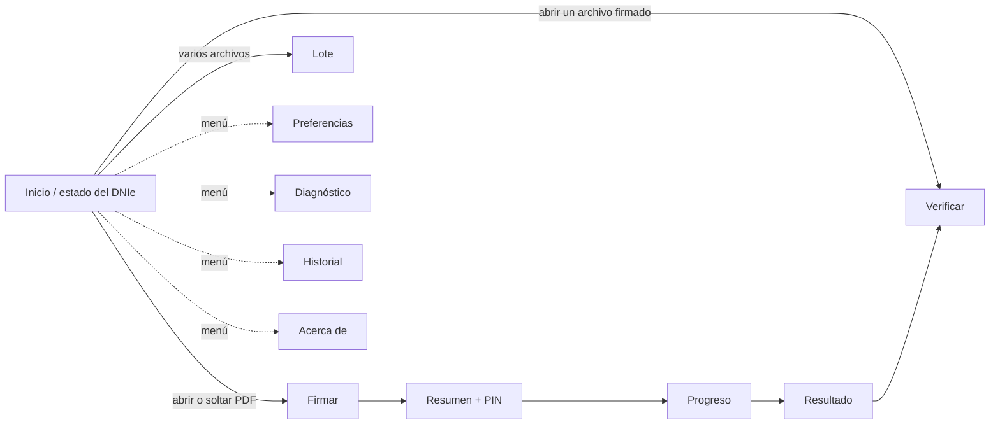

# Diseño de interfaz

| Campo | Valor |
|---|---|
| Documento | BRG-UX-001 |
| Versión | 0.3.1 |
| Estado | Borrador (bocetos de baja fidelidad) |
| Fecha | 2026-10-29 |
| Responsable | noggalito |

## 1. Principios de UX

1. Un camino principal obvio: abrir → revisar → firmar → listo.
2. El estado del DNIe siempre está visible: lector, tarjeta y titular.
3. Lenguaje llano: "Firma con sello de tiempo" antes que "B-T". El código técnico aparece como texto secundario.
4. No hay sorpresas legales: el nivel, el certificado y el documento se muestran antes del PIN.
5. Errores accionables: qué pasó, por qué y qué hacer, con un botón hacia el diagnóstico.
6. Cumplimiento de la HIG de GNOME y de libadwaita: `AdwHeaderBar`, `AdwToastOverlay`, `AdwPreferencesDialog`, `AdwStatusPage`.
7. Dos idiomas con el mismo cuidado: cada texto se redacta en es_PE y en quechua con el mismo tono llano. No se traduce palabra por palabra. Los bocetos de §3 están en es_PE; los textos en quechua salen del catálogo, traducidos en línea y con ayuda de IA a partir de un glosario propio, y corregidos por personas hablantes en la versión 1.1 (ADR-0015, DP-14; ADR-0011).
8. Diseño para longitudes variables: ninguna etiqueta depende de una anchura fija, porque los textos pueden crecer hasta un 40 % entre idiomas (RNF-USA-08).

## 1.1 Identidad visual

La identidad de berigna está en [`data/brand/`](../../data/brand/README.md), bajo GPL-3.0-or-later como el resto del proyecto (© 2026 noggalito). Por eso el icono puede acompañar al paquete en Debian.

- Paleta: burdeos `#6B2232`, dorado `#C2A878`, crema `#F5ECE3`, carbón `#231C1E`. Contraste del burdeos sobre crema: 9,5:1.
- El nombre se escribe siempre en minúsculas: berigna.
- La interfaz usa la tipografía y los colores del sistema (HIG de GNOME, libadwaita), con el color de acento que el usuario eligió en GNOME (decisión del 2026-10-28): la marca no fuerza el burdeos en la interfaz, y vive en el icono, el informe, la web y la firma visible. Las tipografías de la marca (Arvo y Source Sans 3) se reservan para el logotipo y las piezas de comunicación, no para la interfaz.
- El icono de la aplicación (`com.noggalito.Berigna`, a color, reducido para tamaños pequeños y simbólico) se hizo el 2026-10-28 a partir del isotipo, sin el nombre (BRG-UX-002 §2).

## 2. Mapa de navegación



## 3. Bocetos

### 3.1 Inicio

```
┌──────────────────────────────────────────────────────────────┐
│ ☰                         berigna                       ─ □ ✕ │
├──────────────────────────────────────────────────────────────┤
│                                                              │
│                         [ icono ]                            │
│                                                              │
│              Arrastra aquí un documento para                 │
│                   firmarlo o verificarlo                     │
│                                                              │
│                  [ Abrir documento… ]                        │
│                                                              │
├──────────────────────────────────────────────────────────────┤
│ ● DNIe listo · NOMBRE APELLIDO APELLIDO · vence 21/01/2028   │
└──────────────────────────────────────────────────────────────┘
  Estados de la barra inferior:
  ○ Conecta un lector de tarjetas          [Diagnóstico]
  ○ Inserta tu DNIe en el lector
  ⚠ Tarjeta no compatible                  [Más información]
  ⚠ Certificado vencido / revocado
```

### 3.2 Firmar

Implementado en la Fase 3, incremento 3; la firma visible, en el incremento 5 (ADR-0018): una lista de apariencia que empieza por "No visible" (después: solo texto, rúbrica, logotipo o código QR) en el panel, y el recuadro sobre la vista previa, que se mueve arrastrándolo y cambia de tamaño arrastrando su esquina inferior derecha (arrastrar el resto de la página la desplaza, como en un visor de documentos), con el sello dibujado en vivo con datos de muestra; en un recuadro más alto que ancho, la imagen va encima del texto. La vista previa abre en la primera página encajada en la ventana; tiene un campo para escribir el número de página y zoom del 50 % al 400 % (botones y Ctrl + rueda). Motivo y ubicación en listas con "Otro". Diferencias con el boceto: los niveles que necesitan una TSA aparecen desactivados mientras no haya una configurada (DP-02); un documento certificado "sin cambios" muestra el motivo y no deja firmar (ERR-307).

```
┌──────────────────────────────────────────────────────────────┐
│ ←  contrato.pdf                                  [ Firmar ]  │
├────────────────────────────────────┬─────────────────────────┤
│                                    │ Nivel de firma          │
│   ┌──────────────────────────┐     │ ◉ Validación a largo    │
│   │                          │     │   plazo (B-LT)          │
│   │   previsualización       │     │ ○ Archivo a largo plazo │
│   │   de la página           │     │   (B-LTA)               │
│   │                          │     │ ○ Con sello de tiempo   │
│   │        ┌────────┐        │     │   (B-T)                 │
│   │        │ firma  │ ←arrastrable │ ○ Básica (B-B)          │
│   │        └────────┘        │     │ ⓘ ¿Qué nivel elegir?    │
│   └──────────────────────────┘     ├─────────────────────────┤
│   ◀  Página 3 de 3  ▶   ─ 100% +   │ Firma visible   [  ●]   │
│                                    │ Apariencia [Rúbrica ▾]  │
│                                    ├─────────────────────────┤
│                                    │ Motivo     [_________]  │
│                                    │ Ubicación  [Lima, Perú] │
│                                    │ ▸ Opciones avanzadas    │
│                                    │   (certificar documento)│
└────────────────────────────────────┴─────────────────────────┘
```

### 3.3 Resumen y PIN

Implementado en la Fase 3, incremento 3, con `Gtk.PasswordEntry` (P-05). Tras un PIN incorrecto el diálogo vuelve a aparecer con los intentos restantes (P-07) y el usuario debe escribir y confirmar de nuevo (P-06); con 0 intentos se explica el bloqueo. El campo se vacía en cuanto se toma el PIN.

```
┌───────────────────────────────────────────────┐
│            Confirmar firma                    │
│                                               │
│  Documento   contrato.pdf (3 páginas)         │
│  Firmante    NOMBRE APELLIDO APELLIDO         │
│  DNI         ****5678                         │
│  Nivel       Validación a largo plazo (B-LT)  │
│  Apariencia  Visible, página 3                │
│                                               │
│  PIN del DNIe  [••••••          ]  👁̸         │
│  ⚠ Te queda 1 intento antes del bloqueo       │
│                                               │
│            [ Cancelar ]   [ Firmar ]          │
└───────────────────────────────────────────────┘
```

### 3.4 Resultado de la verificación

Implementado en la Fase 3, incremento 2. Diferencias con el boceto: la explicación de cada firma va bajo su firmante y los detalles técnicos en una fila desplegable; "Verificar de nuevo" es un botón de la barra de título, visible si algún resultado es indeterminado; cada firma permite guardar la versión del documento que dejó (CU-06).

```
┌──────────────────────────────────────────────────────────────┐
│ ←  informe-firmado.pdf                    [ Exportar ▾ ]     │
├──────────────────────────────────────────────────────────────┤
│  ✔ 2 firmas válidas · El documento no fue modificado         │
│                                                              │
│  ┌ ✔ NOMBRE APELLIDO ──────────────────────────────────────┐ │
│  │ Firmó el 27/10/2026 10:15 (hora certificada por la TSA) │ │
│  │ Nivel B-LT · DNIe · ECEP-RENIEC                         │ │
│  │ ▸ Detalles técnicos                                     │ │
│  └─────────────────────────────────────────────────────────┘ │
│  ┌ ⚠ OTRO FIRMANTE ────────────────────────────────────────┐ │
│  │ No se pudo comprobar la revocación (sin conexión)       │ │
│  │ Resultado: INDETERMINADO                                │ │
│  │ [ Reintentar en línea ]   ▸ Detalles técnicos           │ │
│  └─────────────────────────────────────────────────────────┘ │
└──────────────────────────────────────────────────────────────┘
```

### 3.5 Lote

```
┌──────────────────────────────────────────────────────────────┐
│ ←  Firmar 12 archivos                   [ Firmar 12 ]        │
├──────────────────────────────────────────────────────────────┤
│  Archivo                 Formato            Estado           │
│  acta-01.pdf             PAdES visible      ✔                │
│  acta-02.pdf             PAdES visible      ⟳ firmando…      │
│  datos.xml               XAdES envuelta     ·                │
│  planilla.xlsx           CAdES (.p7s)       ·                │
│  …                                                           │
│  [ + Añadir ]  [ − Quitar ]          Nivel: [B-LT ▾]         │
│  ████████████░░░░░░░░  5 / 12   [ Cancelar ]                 │
└──────────────────────────────────────────────────────────────┘
```

Implementado en la Fase 3, incremento 6, solo con PDF (los demás formatos llegan en la Fase 4). Se entra con "Firmar varios documentos…" en la pantalla inicial, abriendo o arrastrando varios archivos a la vez, o una carpeta. La lista se construye en la misma página (añadir documentos, añadir una carpeta con o sin subcarpetas, quitar); lo que se firma es cada archivo tal como estaba al añadirlo (su SHA-256). El nivel y los datos de la firma son los de la firma individual. Diferencias con el boceto: la confirmación es el diálogo del PIN, que indica el número de documentos; las firmas del lote no son visibles; los archivos que fallan las comprobaciones previas se informan sin pedir el PIN por ellos; dos archivos del mismo nombre en una misma carpeta de salida se numeran. Resultado: una fila por archivo y los botones "Exportar el informe…" (CSV), "Mostrar en la carpeta" y "Firmar otros documentos", que deja en la lista los que no se firmaron.

## 4. Textos de los niveles (borrador)

| Nivel | Título (es_PE) | Descripción (es_PE) | Title (en_US) | Description (en_US) |
|---|---|---|---|---|
| B-B | Básica | Firma sin sello de tiempo. La fecha la declara tu equipo. | Basic | Signature without a timestamp. The date is declared by your computer. |
| B-T | Con sello de tiempo | Una autoridad de sellado certifica la fecha y la hora de la firma. | With timestamp | A timestamping authority certifies the date and time of the signature. |
| B-LT | Validación a largo plazo | Incluye además la información necesaria para verificar la firma años después. Recomendado. | Long-term validation | Also includes the information needed to verify the signature years from now. Recommended. |
| B-LTA | Archivo a largo plazo | Protege la firma contra la obsolescencia criptográfica. Para documentos que deban conservarse muchos años. | Long-term archival | Protects the signature against cryptographic obsolescence. For documents that must be kept for many years. |

Las columnas en_US se conservan para la versión 1.1. Los textos en quechua se traducen a partir de las columnas es_PE (ADR-0015).

## 4.1 Selector de idioma

En "Preferencias → General → Idioma" se elige entre "Usar el idioma del sistema", "Español (Perú)" y "Runasimi (quechua)". Cada idioma aparece escrito en su propia lengua. El cambio se aplica al momento, sin reiniciar: berigna reconstruye la ventana en el nuevo idioma y vuelve a abrir el documento en curso. El idioma del informe PDF se elige en el propio diálogo de exportación.

## 4.2 Aviso de traducción sin revisar

Hasta que la traducción al quechua tenga corrección humana (versión 1.1, DP-14), berigna lo dice abiertamente:

- Con la interfaz en quechua, la ventana principal muestra un `AdwBanner` con el texto, en quechua y en español, "Traducción sin revisar por hablantes. En caso de duda, prevalece el texto en español" y el botón "Ver en español", que cambia `ui-language` a es_PE (al momento, §4.1). No se puede cerrar: `AdwBanner` admite un solo botón, y el aviso debe seguir visible mientras la interfaz esté en quechua.
- El diálogo del PIN y el resultado de la verificación en quechua incluyen el enlace "Ver en español", que muestra el mismo texto en es_PE sin cambiar de idioma.
- El informe PDF en quechua añade la misma advertencia junto a la nota de prevalencia del español (ADR-0015, punto 7).
- El aviso desaparece en la versión que incorpore la corrección por personas.

## 4.3 Preferencias

Implementado en la Fase 3, incremento 4 (CU-08), como `AdwPreferencesDialog` con tres páginas:

- General: idioma de la interfaz; nivel por defecto, algoritmo de *hash*, sufijo y carpeta de los archivos firmados.
- Red: dirección de la TSA con el botón "Probar"; tiempo de espera; proxy del sistema, manual o ninguno.
- Confianza: estado de la TSL de INDECOPI (secuencia, fechas y número de CA acreditadas) y "Actualizar ahora".

Cambiar el idioma reconstruye la ventana y vuelve a abrir las Preferencias en el nuevo idioma. En las listas desplegables el valor elegido va como subtítulo, completo, y las opciones de la lista se ajustan en varias líneas en vez de cortarse. Las opciones técnicas tienen un botón "Más información" que abre la ayuda en línea de esa versión (ADR-0017). Pendiente: ver el contenido del almacén de confianza (RF-060) y la autenticación con la TSA (RF-062).

## 4.4 Diagnóstico

Implementado en la Fase 3, incremento 6 (CU-07, RF-007). Se abre desde el menú principal ("Diagnóstico") y desde el botón "Diagnóstico" de los errores de lector, tarjeta o certificado; se apila sobre la página actual, de modo que "volver" regresa a ella. Comprueba en orden: servicio `pcscd`, lector, tarjeta, certificado de firma (sin PIN, con aviso si vence en menos de un mes), confianza y revocación en línea, y autoridad de sellado de tiempo. Cada paso muestra ✓, ⚠, ✗ u omitido, con una acción sugerida; los pasos que dependen de uno que falló se omiten. "Copiar el informe" copia el resultado con la versión de berigna y del sistema, sin PIN y con el DNI enmascarado; "Abrir la carpeta del registro" abre `~/.local/state/berigna/logs/` (RF-083).

## 4.5 Historial y certificados de confianza

Implementados en la Fase 3, incremento 6. Historial (RF-082; menú principal → Historial, Ctrl+H): las firmas, las firmas de lote y las verificaciones, la más reciente primero, con búsqueda por nombre, firmante o SHA-256, "Exportar a CSV" y "Borrar el historial" (con confirmación). Se activa o desactiva, y se elige guardar la ruta completa, en Preferencias → General → Historial. Certificados de confianza (RF-060): Preferencias → Confianza, agrupados por origen (incluidos en berigna, de la lista de INDECOPI, añadidos por el usuario), con el papel, la vigencia, la jerarquía y el SHA-256 seleccionable.

## 5. Pendientes

- [ ] Prototipo de alta fidelidad (Figma o Penpot) de las cinco vistas.
- [x] Icono de la aplicación según la guía de iconos de GNOME (BRG-UX-002 §2).
- [ ] Prueba de usabilidad (RNF-USA-06) en la Fase 3.
- [ ] Microcopia completa de errores (catálogo `ERR-xxx`, con su mensaje, su causa y la acción sugerida) en es_PE y en quechua.
- [x] Aviso de traducción sin revisar en la ventana principal, en el informe PDF en quechua y "Ver en español" en el diálogo del PIN (§4.2). Falta "Ver en español" en el resultado de la verificación.
- [ ] Glosario terminológico bilingüe para traductores (por ejemplo: sello de tiempo / timestamp, firmante / signer, revocado / revoked), para mantener la coherencia.
- [ ] Revisión de los bocetos en quechua para detectar textos que se desborden (las palabras aglutinantes suelen ser largas).
